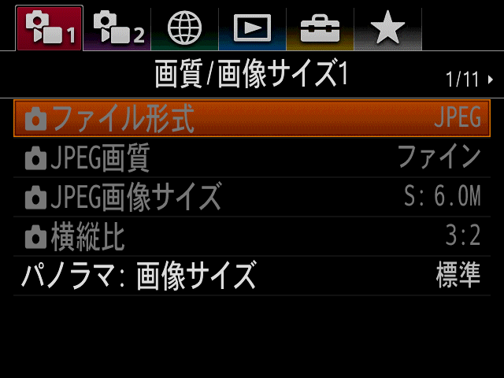

# ZV-E10 QEMU 模拟器

本项目已暂停，后续进展请参阅 https://github.com/cokeenet/zve10-qemu


在 Linux 电脑上启动 Sony ZV-E10 的原厂系统，并显示原厂菜单，无需连接相机。项目参考 [A7C II QEMU](https://github.com/chocotan/a7c2-qemu) 的软件绘图方式实现。

目前可以启动到命令行，并将原厂菜单保存为 640×480 图片。菜单里的布局、图标、文字和字体都来自相机固件。



## 可以做什么

- **启动原厂系统**：运行 ZV-E10 2.03 的相机程序，进入串口命令行。
- **显示原厂菜单**：用软件绘图生成 640×480 菜单画面，包含原厂图标、日文文字、选中条和设置值。
- **保存菜单图片**：自动等待菜单加载，将画面保存为 PNG，供查看和研究。
- **查看运行日志**：通过终端观察系统启动、程序加载和绘图过程。

目前没有可点击的相机窗口，按键、拨盘和其他菜单页面的交互还未完成。没有取景、拍照和录像功能，也没有模拟传感器、镜头和负责成像的处理器。

## 第一次启动前

需要 Linux x86_64、Python 3、Pillow、GCC、Make、Ninja、Meson、cpio、7-Zip、e2fsprogs 和 fakeroot。编译 QEMU 还需要 GLib 和 Pixman 开发包，编译相机内核和绘图程序需要 ARM 交叉工具链。

固件、Linux 源码和工具链需要自行下载，仓库不包含这些大文件。

| 文件 | 下载地址 | 放置位置 |
| --- | --- | --- |
| ZV-E10 2.03 固件更新包 | [Sony 官方下载页面](https://www.sony.com/electronics/support/e-mount-body-zv-e-series/zv-e10/downloads) | 仓库根目录下的 `Update_ZVE10V203.dmg` |
| Sony Linux 源码 | [linux-kernel.tar.gz](https://prodgpl.blob.core.windows.net/download/DI/ZV-E10_Ver.2.02/linux-kernel.tar.gz) | `work/linux-kernel.tar.gz` |
| QEMU 11.1.2 源码 | [qemu-11.1.2.tar.xz](https://download.qemu.org/qemu-11.1.2.tar.xz) | `work/qemu-11.1.2.tar.xz` |
| ARM 交叉工具链 | [Bootlin armv7-eabihf，2020.08-1](https://toolchains.bootlin.com/downloads/releases/toolchains/armv7-eabihf/tarballs/armv7-eabihf--glibc--stable-2020.08-1.tar.bz2) | `work/armv7-toolchain.tar.bz2` |

固件请使用 **ZV-E10 2.03**，不要使用 ZV-E10 II 的更新包。Linux 源码由 Sony 放在 `ZV-E10_Ver.2.02` 目录下，内核版本为 3.0.27。

下载并解压后，启动程序使用以下目录：

```text
zve10-qemu/
├── Update_ZVE10V203.dmg
└── work/
    ├── armv7-eabihf--glibc--stable-2020.08-1/
    ├── qemu-src/
    ├── linux-kernel/
    ├── kbuild-clean/
    ├── kbuild-ui/
    ├── usr/
    ├── initramfs-camera/
    └── initramfs-ui/
```

安装好依赖、解包工具和 ARM 工具链后，用以下两个命令准备固件和启动文件系统：

```bash
python3 scripts/prepare-firmware.py --fwtool-python work/fwtool-venv/bin/python
fakeroot -s work/fakeroot.state python3 scripts/prepare-initramfs.py
```

接下来应用内核与 QEMU 补丁、编译内核和本地模块。完整步骤见 [准备与编译](docs/setup.md)。这套流程已从下载的源码和更新包跑通，能启动到命令行并生成上图的菜单。

## 运行

准备好固件文件和编译产物后，在仓库根目录执行。

启动到命令行：

```bash
./start-zve10.sh
```

启动原厂应用并导出菜单图片：

```bash
python3 scripts/capture-menu.py
```

等待菜单文字加载完成后，程序会保存图片并关闭自己启动的模拟器。终端会打印图片路径；打开其中的 `preview_png` 即可查看菜单。

生成的图片位于 `output/`，文件名包含帧号和像素摘要，例如 `zve10-menu-frame19-d68731fe.png`。

只启动原厂应用、保留串口日志而不自动截图：

```bash
./start-zve10-ui.sh
```

## 为了让原厂系统运行，做了哪些适配

1. **补上相机的启动硬件**：为 QEMU 增加 ZV-E10 机型，配置内存、ARM 处理器、中断控制器、串口和相机使用的九路定时器，让原厂 Linux 能正常启动、计时和唤醒线程。
2. **修正旧内核的编译和启动问题**：适配 ARM 交叉编译器，修复启动参数传递以及线程退出时的内存写入问题，使原厂应用能完成初始化。
3. **准备相机运行环境**：从固件更新包提取系统文件、相机程序和资源，制作启动文件系统，并调整应用加载配置，使菜单能在没有成像硬件的情况下运行。
4. **用 CPU 完成菜单绘图**：保留原厂菜单布局、字体和图片资源，在软件中完成菜单需要的矩形、纹理、文字透明度、清屏和图像复制操作。
5. **补上资源解码和画面输出**：用 Sony 开源代码中的算法解压原厂图片，处理原厂画面缓冲和完成通知，等文字、图标加载后再导出菜单图片。

这些适配让原厂程序自己生成菜单内容。截图不是重新绘制的仿制界面。

## 当前限制

- 已支持原厂菜单首页的图片输出，其他页面和按键操作尚未验证。
- 绘图由 CPU 完成，只实现了当前菜单需要的格式和操作，遇到不支持的绘图命令会停止并输出日志。
- 没有模拟传感器、镜头或负责成像的处理器，因此没有取景、拍照和录像功能。
- 所有操作都在电脑上的模拟器中进行，不需要给真实相机刷机。

## 源码和许可

项目代码、QEMU 修改、内核补丁及测试代码保存在仓库中。Sony 固件和解包后的相机程序由使用者自行准备。

第三方源码的来源和许可证见 [THIRD-PARTY.md](THIRD-PARTY.md)。
