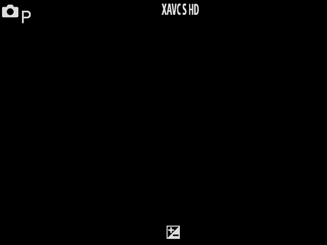
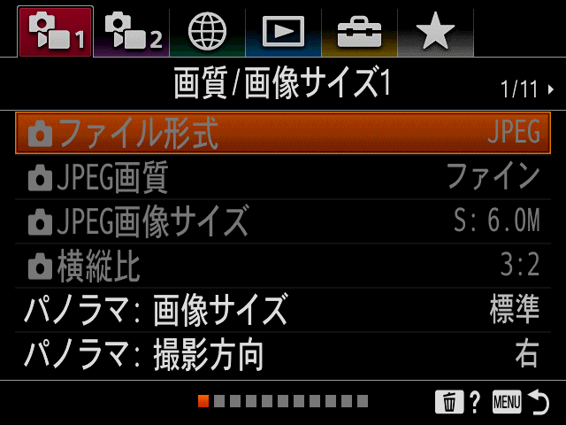

# ZV-E10 QEMU 模拟器

在 Linux 电脑上运行 Sony ZV-E10 2.03 原厂系统，显示原厂菜单。**默认使用 ZV-E10 原菜单，不需要 A7C2 固件或资源。** A7C2 原资源菜单是显式启用的可选实验模式。

当前可以启动原系统命令行、显示原厂菜单并通过原 UI 线程导航。显式拍摄页模式已能显示原 AP 绘制的拍摄主界面（相机/P、`XAVC S HD` 与曝光图标）；没有实时取景、拍照或录像，传感器、镜头和成像处理器尚未模拟。

**原拍摄主界面（`shoot-menu-final-v84`）**



**原厂菜单（全服务 `full-menu-v76` 验收截图）**



两张图都是原 AP 的 640×480 LCD 输出，不是主机自绘界面。它们分别证明拍摄页显示与原菜单模式；**拍摄页按 MENU 进入菜单的同次闭环仍未通过**，不能把两张图理解为该切换已经验收。

## 启动

以下命令在本目录执行。首次使用先完成 [准备与编译](docs/setup.md)；用户固件、工具链和生成镜像不包含在 Git 中。本机已准备的运行文件位于本目录自己的 `work/`，不依赖其它研究仓库。

**默认：原厂菜单窗口**

```bash
./start-zve10-menu.sh
```

窗口显示原 AP 产生的640×480帧；方向键或窗口方向按钮经原 EventManager 和原 UI 线程处理。原版预览只开放方向导航，不确认设置动作。原菜单树不新增 `New Menu` 行，不读取 A7C2 资源。

**实验：原拍摄主界面**

```bash
./start-zve10-menu.sh --start-page shoot --shoot-view --capture-table-model
```

该路径通过原 RootSelector 请求 `ViewStlrec(0xc3)`，CaptureId 表模型只提供挥发性 RAM 事务。启动仍可能遇到原 AP 的非确定性异常；失败会保留在独立输出目录。拍摄页 MENU 探测使用原事件 `0x150100f0`，当前只记录实际消费与像素，不把事件入队记为切页成功。

恢复原厂服务的菜单模式也已单独通过：

```bash
./start-zve10-menu.sh --full-services
```

**原系统命令行**

```bash
./start-zve10.sh
```

**原厂 UI 串口运行 / 原截图流程**

```bash
./start-zve10-ui.sh
python3 scripts/capture-menu.py
```

这是两个独立启动方式，不需要同时运行；`start-zve10-ui.sh` 保留原串口启动行为。

## 可选：A7C2 原资源菜单

将已提供的 `a7c2-menu-resources-2.01-v1.zip` 放到被忽略的 `incoming/`，无需自己整理十个文件：

```bash
./start-zve10-menu.sh \
  --a7c2-assets incoming/a7c2-menu-resources-2.01-v1.zip
```

启动器会校验ZIP白名单、尺寸和固定SHA，将素材导入本机 `work/`。原设置5页增加一个新行，ENTER进入八分类空菜单，Esc/MENU返回原页并恢复焦点。窗口 × 正常关闭控制线程及 QEMU。原资源不上传 Git。

新增行文案由本适配在 guest 内用 A7C2 原字体绘制到该行标签框（原 AP 只绘制已有资源布局的标签），因此**不经过原标签管线**；其它行文案例外不变。旧报告里“原标签管线绘制标题”的说法不可复现，该否定结论保留在 [机器验收](docs/menu-validation.json)。

也可先导入到固定位置，再单独启用：

```bash
python3 scripts/menu_resources.py \
  --bundle incoming/a7c2-menu-resources-2.01-v1.zip \
  --destination work/a7c2-menu-assets
./start-zve10-menu.sh --a7c2-menu
```

`--a7c2-menu` 不存在默认素材时明确报错；不会悄悄回到原版或下载资源。不加该选项、不传素材时始终为原版。

这里复用 A7C2 2.01 的原布局、图标、中文文案及字体，由同一 ZV-E10 AP 内的可读 C 合成；不会执行 A7C2 的64位程序。新菜单内容区为空，没有设置写回或完整菜单 SDK。详见 [菜单模式与开发接口](docs/menu-modes.md) 与 [机器验收](docs/menu-validation.json)。

## 验证与输出

默认每次创建独立 `output/menu-<id>/`，保存构建收据、原输入消费、帧摘要、PNG和正常退出结果。可用 `--out` 指定一个尚不存在的目录。

```bash
./start-zve10-menu.sh --headless
xvfb-run -a -s '-screen 0 800x640x24 -nolisten tcp' \
  ./start-zve10-menu.sh --self-test
```

上述两条都是**原版**检查。可选模式检查在同一命令追加 `--a7c2-assets incoming/a7c2-menu-resources-2.01-v1.zip`。无图形会话时用 `--headless`，有图形会话可直接运行默认窗口。

[功能与验收记录](docs/menu-validation.json) 分别记录原版和A7C2模式；普通交互正常关闭与完整语义验收分账，不把启动成功当作拍摄功能通过。

## 一键运行包（本机交付）

`release/zve10-qemu-linux-x86_64-v1.tar.gz` 由 `scripts/package-ready.py` 从本目录已验文件生成，包含：源码、编译好的 QEMU 与逐项核验的动态库闭包、内核与已准备启动 CPIO、原三个业务 ELF、ARMv7 工具链、**官方 ZV-E10 2.03 更新包**，以及可选的 A7C2 最小资源 ZIP。

```bash
tar -xzf zve10-qemu-linux-x86_64-v1.tar.gz
cd zve10-qemu-linux-x86_64-v1
./start.sh              # 原版菜单（默认）
./start-a7c2.sh         # 可选 A7C2 菜单
./start.sh --headless   # 无桌面时的可验证运行
```

包内 `BUNDLE-MANIFEST.json` 记录每个文件的尺寸与 SHA-256，`start.sh` 会先检查 Linux x86_64、Python 3.11+ 与 Pillow/pyelftools/capstone（窗口另需 Tk）。主机仍需普通 Python 依赖，包不自带 Python。

包很大（约 720 MiB，解压约 1.3 GiB），含原厂固件，只作本机研究交付，不进入 Git；`release/` 已被忽略。既有 v1 一键包仍是菜单版，未包含本轮拍摄页改动；取景/拍照仍未实现。

Linux x86_64、Python 3.11+、host GCC、Pillow、pyelftools、capstone；窗口模式另需Tk/X11，测试使用pytest。ZV-E10固件、Sony GPL Linux、QEMU11.1.2及Bootlin ARMv7工具链的来源和编译步骤见 [docs/setup.md](docs/setup.md)。

当前菜单适配绑定已验证原ELF/原profile的SHA和ABI。不同主机重新构建的QEMU/内核若字节不同，需要先验证新构建来源，不能删掉守卫冒充兼容。

项目代码与必要软件图形模块在 `source/`，构建/运行工具在 `scripts/`，检查在 `tests/`。Sony原件与生成DSO/CPIO保存在忽略的 `incoming/`、`work/` 和 `output/`，不随源码发布。第三方来源及许可见 [THIRD-PARTY.md](THIRD-PARTY.md)。
